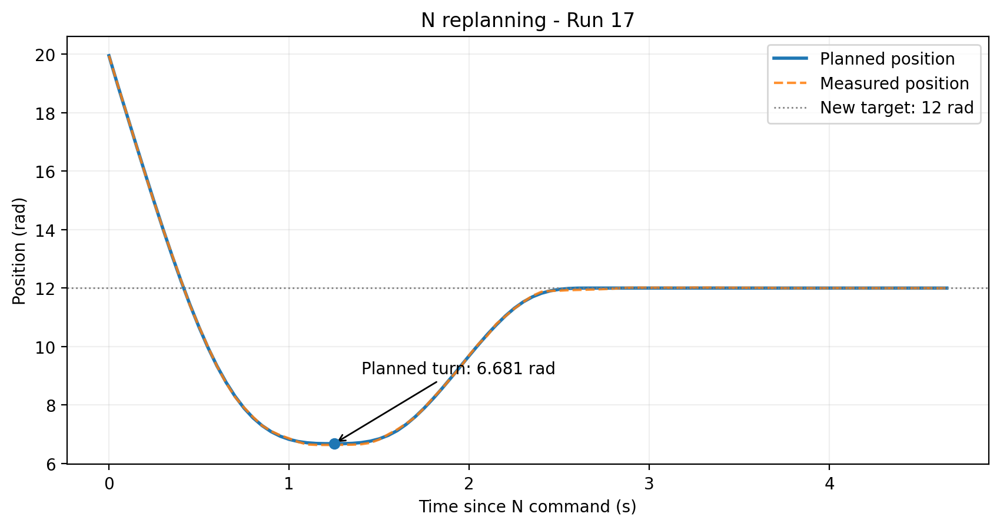
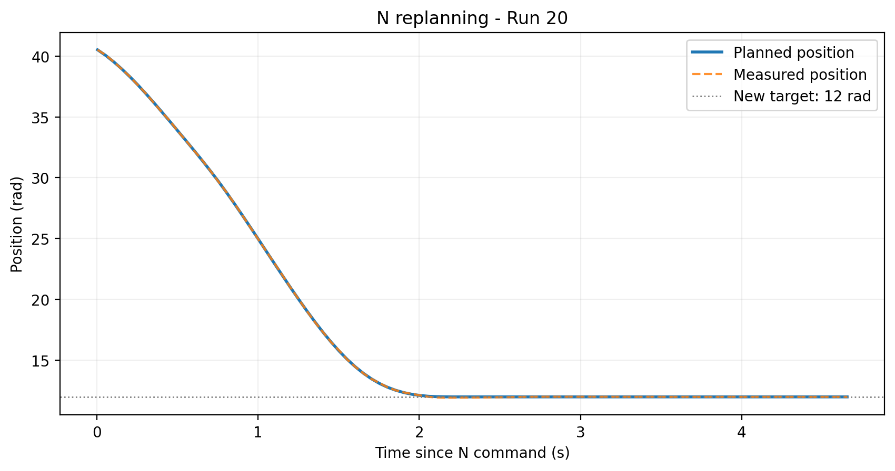

# ESP32 FOC Motion Control

**基于 ESP32、DengFOC-V4 和 SimpleFOC 的单轴无刷电机闭环控制与在线轨迹规划系统**

本项目在 DengFOC-V4 硬件和 SimpleFOC 库的基础上，集成单轴电机闭环控制、梯形速度规划、七阶段 S 曲线、在线目标重规划、受控停止和运行诊断。项目提供可烧录的模块化 C++ 固件，以及由真实电机采集的运动跟踪数据。

> **验证状态：** 已在 ESP32 + 实际电机上运行模块化固件，并完成 B/C/P/N 功能、串口状态输出和 21 通道 CSV 的测试。本文结果只来自已执行的实机实验，不代表所有负载或工况均已验证。

## 核心功能

- **闭环电机控制：** 基于 SimpleFOC 的电流、速度和位置控制，结合速度前馈。
- **轨迹规划：** 梯形速度规划、七阶段 Jerk 受限 S 曲线及自动往返。
- **运动中修改目标：** `N` 支持从当前规划状态进行在线重规划；必要时先制动、越程，再反向返回目标。
- **受控停止与诊断：** `P` 受控停止、位置 RMSE、跟踪误差、控制耗时、电流监测和 21 通道 CSV。

## 软件结构

```text
firmware/ESP32_FOC_Motion_Control/
├── ESP32_FOC_Motion_Control.ino   主程序入口
├── Config.h / Runtime.h          参数与共享状态
├── MotorControl.h/.cpp           电机初始化与闭环执行
├── TrajectoryPlanner.h/.cpp      梯形、S 曲线及在线轨迹计算
├── MotionController.h/.cpp       运动状态、接管和自动往返
├── SerialProtocol.h/.cpp         串口指令解析
├── Diagnostics.h/.cpp            运行性能与跟踪误差统计
└── Telemetry.h/.cpp              非阻塞串口与 CSV 输出
```

详细说明：[系统架构](docs/architecture.md) · [硬件配置](docs/hardware.md) · [串口指令](docs/commands.md)

## 实机测试结果

| 指标 | 实测结果 | 来源 |
| --- | ---: | --- |
| 运动阶段总体位置 RMSE | **0.02412 rad** | 21 通道实测 CSV，344 个运动样本 |
| 最大采样位置跟踪误差 | **0.07000 rad** | 同一 CSV |
| 在线重规划：越程反向（Run 17）RMSE | **0.03119 rad** | 实测 CSV |
| 在线重规划：直接到达（Run 20）RMSE | **0.02511 rad** | 实测 CSV |
| 平均主循环间隔 | **388 μs** | 另一次实机串口诊断记录 |
| 平均 FOC 耗时 | **324 μs** | 同一串口诊断记录 |
| N 求解耗时 | **1.865 ms** | 同一串口诊断记录 |

**在线重规划：越程制动后返回目标。** 规划位置从约 19.944 rad 继续向负方向运动，在约 6.681 rad 处反向，最后到达 12 rad。



**在线重规划：直接到达目标。** 规划从约 40.508 rad 向 12 rad 运动。



完整的采样方法、逐段结果及数据说明见 [实验结果](experiments/results.md)。以上为单轴测试结果；规划速度限制不等于对电机实际瞬时速度、加速度和 Jerk 的独立认证。

## 硬件与开发环境

| 项目 | 配置 |
| --- | --- |
| 控制板 | DengFOC-V4（ESP32） |
| 电机 | 7 极对 BLDC（当前示例配置） |
| 位置传感器 | AS5600（I²C） |
| 电流采样 | InlineCurrentSense，分流电阻 0.01 Ω、增益 50 |
| 底层控制库 | SimpleFOC 2.2.1（外部安装） |
| 串口 | 115200 baud；CSV 默认设计频率 20 Hz |

引脚与实际接线参见 [hardware.md](docs/hardware.md)。

## 编译与运行

1. 在 Arduino IDE 中安装对应的 ESP32 开发板支持包，以及 **SimpleFOC 2.2.1**。
2. 打开 `firmware/ESP32_FOC_Motion_Control/ESP32_FOC_Motion_Control.ino`；保留同目录全部 `.h/.cpp` 文件。
3. 确认控制板引脚、编码器、电流采样和电源接线，使用有实体断电手段的安全测试环境。
4. 烧录后以 **115200** 波特率打开串口，发送 `S` 查看状态，发送 `?` 查看帮助。
5. 在有足够安全转动空间的条件下，从低速开始验证，如 `C2,4,60,8,3`；运动中可发送 `N12` 测试**绝对目标**重规划。

完整指令及参数解释见 [commands.md](docs/commands.md)。**`P` 是软件受控停止，不是硬件急停；电流限值和位置软限位不能替代物理保护。**

## 第三方依赖与致谢

本项目使用 [DengFOC](https://github.com/ToanTech/Deng-s-foc-controller) 硬件及参考工程，并通过 [SimpleFOC](https://github.com/simplefoc/Arduino-FOC) 完成底层 FOC 控制。应用层轨迹规划、指令调度、重规划、数据监测与系统集成建立在这些基础上。感谢上述开源项目的作者和贡献者。

关于参考代码的来源与许可证核查，参见 [THIRD_PARTY_NOTICES.md](THIRD_PARTY_NOTICES.md)。
