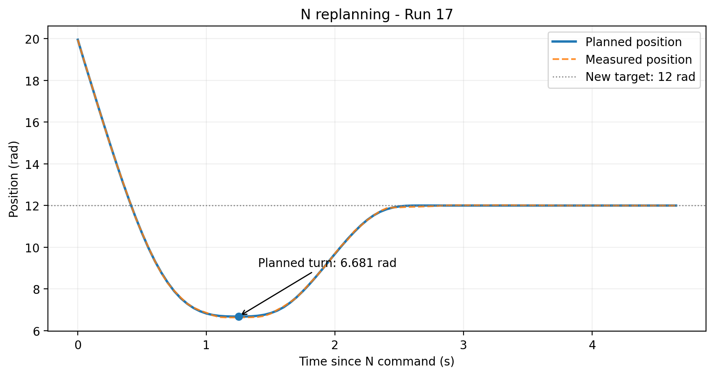
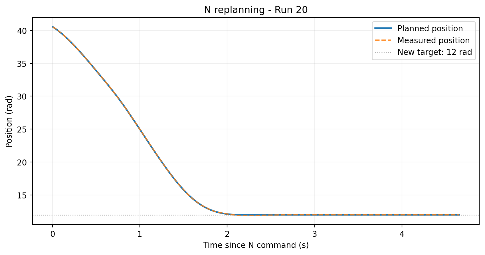

# 实机实验结果

本页只展示 **ESP32 模块化固件真实运行后采集到的数据**，不展示开发历史或电脑模拟测试结果。

## 数据来源与计算方法

- 数据文件：[motor_trace.csv](data/motor_trace.csv)，来自 VOFA/串口输出。
- 共 **1,801 行、21 列**，记录持续约 **90.002 s**，采样间隔基本为 **50 ms**（约 20 Hz），无缺失值。
- **仅使用 phase=1、2、3 的运动样本**计算位置 RMSE，避免将长时间静止数据混入运动误差；共 **344 个样本**。
- 位置误差 `e = 规划位置(I4) − 实测位置(I5)`，`RMSE = sqrt(mean(e²))`。
- 采集期间发送丢弃计数 I20 始终为 0；指令拒绝累计值 I17 始终为 1，说明此次 CSV 采集期间没有新增拒绝（并非设备历史累计拒绝为零）。

| 结果 | 数值 |
| --- | ---: |
| 全部运动样本总体 RMSE | **0.02412 rad** |
| 全部运动样本最大绝对位置误差 | **0.07000 rad** |
| 最大采样规划速度绝对值 | **20.000 rad/s** |
| 最大采样实测速度绝对值（原始速度估计） | **23.697 rad/s** |
| 实测 Iq 最大采样绝对值 | **0.0909 A** |

以上速度、电流极值均来自离散记录，不等于连续时间物理峰值。规划速度没有超出20 rad/s，但原始 AS5600 速度估计出现短时尖峰，不能用20 Hz CSV 断言实际瞬时速度全程满足上限。

## 分段运动位置跟踪

| Run | 类型 | 运动样本数 | RMSE (rad) | 最大位置误差 (rad) | 采样规划速度峰值 (rad/s) |
| ---: | --- | ---: | ---: | ---: | ---: |
| 13 | C 运动 | 53 | 0.02139 | 0.04730 | 20.000 |
| 14 | C 运动 | 53 | 0.02081 | 0.06100 | 20.000 |
| 15 | C 运动 | 54 | 0.02255 | 0.06510 | 20.000 |
| 16 | C 被 N 接管 | 21 | 0.02058 | 0.04170 | 19.506 |
| 17 | N 越程返回 | 54 | 0.03119 | 0.06040 | 19.986 |
| 18 | C 运动 | 54 | 0.02184 | 0.05660 | 20.000 |
| 19 | C 被 N 接管 | 10 | 0.03150 | 0.06060 | 6.956 |
| 20 | N 直接到达 | 45 | 0.02511 | 0.07000 | 20.000 |

Run 16、19 是被在线指令接管的 C 轨迹，表格中的 RMSE 只代表被接管前的运动部分。以上是由 CSV 重新计算的结果，并非不同 Run 的简单平均。

## 两组在线重规划实验

**Run 17：越程后反向返回**

规划从约 **19.944 rad** 继续沿负方向减速，到约 **6.681 rad** 反向，最终到达绝对目标 **12 rad**。运动样本 RMSE 为 **0.03119 rad**。

**Run 20：直接到达**

规划从约 **40.508 rad** 继续向绝对目标 **12 rad** 运动，运动样本 RMSE 为 **0.02511 rad**。

## 独立实机串口诊断记录

另一组电机实机运行的文字日志验证了梯形自动往返、S 曲线、P 受控停止和 N 直接接管；其诊断输出中包括：

| 指标 | 实测值 |
| --- | ---: |
| 平均主循环间隔 | **388 μs** |
| 最大主循环间隔 | **4268 μs** |
| 平均 FOC 执行耗时 | **324 μs** |
| N 求解耗时 | **1865 μs** |
| N 完整指令处理耗时 | **1928 μs** |
| N 直接接管运动 RMSE | **0.02649 rad** |
| P 受控停止运动 RMSE | **0.02672 rad** |

这组诊断数据**不是上述 CSV 中 Run 17/20 的同一次实验**，因此不能将两者的时延与 RMSE 配对为同一次运行。数据为特定条件下的测量，不代表各工况的最坏情况上界。

## 边界与安全说明

- 这些数据表明所测工况下的轨迹跟踪正常，不能证明所有初始状态或全部负载条件下的安全性。
- 20 Hz 的位置/速度采样无法独立验证电机实际瞬时加速度与 Jerk 全程满足设定约束。
- 电流限幅、软件角度限制和 P 受控停止均不能替代硬件保护。
